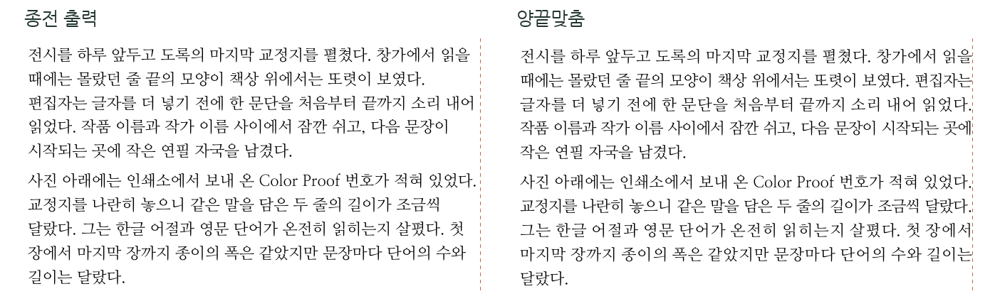

# 쪽결

쪽결은 한글·영문 마크다운 원고를 책과 보고서용 PDF로 조판하는 편집기입니다. 이 브랜치에는 Docker 웹판과 네이티브 데스크톱 개발판이 함께 들어 있습니다. 판형과 여백을 정하면 한글 어절과 영문 단어의 경계에서 줄을 나누고, 허용한 범위 안에서 자간과 어절 사이 공백을 조정해 본문 양끝을 맞춥니다. 문단의 마지막 줄은 자연스러운 길이로 둡니다.



[비교에 사용한 원고](proofs/justified-publication/manuscript.md) · [양끝맞춤 PDF](proofs/justified-publication/after.pdf)

## 배포 상태

네이티브 내부 시험판은 비공개 GitHub Releases에서 관리합니다. 배포 배치는 Windows x64 설치 프로그램, Apple Silicon Mac용 DMG, Ubuntu 24.04 x86_64용 DEB를 만들고, 설치물에서 기준 PDF를 대조한 뒤 다운로드 파일과 SHA-256을 초안에 올립니다. [릴리즈 목록](https://github.com/WizMasia/jjokgyeol/releases) · [설치 및 배치 실행 방법](desktop/release/README.md)

### 네이티브 개발판과 웹판 비교

`feature/native-desktop`에서 Tauri 편집 창과 Rust 실행기를 개발합니다. 비교 기준은 `main`의 `6b8da3a`입니다. 두 앱에서 같은 UTF-8 원고와 저장 양식을 열고 규칙 조판을 선택하면, 아래 명령으로 쪽 수·줄 끝·글꼴·좌표를 대조할 수 있습니다.

```sh
python desktop/qa/compare_pdfs.py 네이티브.pdf 웹판.pdf
```

Mac 개발 앱에서 원고를 열고 편집한 뒤 PDF를 미리보고 저장했습니다. 원고만 고치거나 양식만 고친 경우 각각 창 닫기를 취소하면 수정값이 보존됩니다. 양면 줄 번호, 9단계 목록, 일반 보고서, 주석의 본문 크기 변경(11pt·16pt), 양끝맞춤 예제와 새 원고의 지면이 웹판과 일치했습니다. Mac 앱을 다른 폴더로 복사하고 네트워크와 개발 저장소 읽기를 차단한 상태에서도 같은 양면 PDF가 생성됐습니다. 데스크톱 개발판은 규칙 조판을 지원합니다. 웹판에서는 모델판과 규칙판을 선택할 수 있습니다. [네이티브 앱 빌드](desktop/gui/README.md) · [조판 작업자 준비](desktop/worker/README.md) · [Windows 검증](desktop/qa/runtime/README.md) · [Linux 검증](desktop/qa/linux/README.md)

Windows x64와 Debian x86_64에서 Rust 실행기가 생성한 양면 줄 번호 PDF도 같은 비교를 통과했습니다. Windows x64와 Ubuntu 24.04에서는 쪽결의 설정 버튼으로 별도 창을 열고, 설정창을 닫은 뒤에도 원고 창이 열려 있음을 확인했습니다. [Windows 조판·창 검사](https://github.com/WizMasia/jjokgyeol/actions/runs/44744324666) · [Linux 조판·창 검사](https://github.com/WizMasia/jjokgyeol/actions/runs/44744324648)

## 내 컴퓨터에서 실행하기

Docker와 Linux ARM64 컨테이너를 실행할 수 있는 환경이 필요합니다. 저장소를 받은 뒤 `Dockerfile`이 있는 폴더에서 실행합니다. 첫 빌드는 TeX와 나눔 글꼴 등의 의존성을 내려받습니다. 이후 기본 규칙 조판은 로컬에서 작동합니다.

```sh
docker build --platform linux/arm64 --target local -t jjokgyeol:local-editor .
docker run -d --name jjokgyeol-local -p 127.0.0.1:8780:8000 jjokgyeol:local-editor
```

[로컬 편집기 열기](http://127.0.0.1:8780/). 예제 원고와 첫 PDF가 표시되면 준비된 상태입니다. 작업을 마칠 때는 `docker stop jjokgyeol-local`, 다음에 다시 열 때는 `docker start jjokgyeol-local`을 사용합니다.

## 첫 PDF 만들기

1. **원고 열기**에서 UTF-8 마크다운 파일을 선택합니다. TXT·HTML·DOCX·HWPX·HWP 5 파일은 **원고 가져오기**를 사용합니다. 변환 중 달라진 요소는 원고 아래 경고에서 확인할 수 있습니다.
2. 새 원고의 기본값은 A5, 나눔명조 11pt, 행간 17pt입니다. **설정 → 판형·여백 및 세부 양식**에서 판형과 여백, 첫 줄·이후 줄 들여쓰기(mm 또는 pt), 자간과 어절 공백의 허용 범위를 조정합니다.
3. **미리보기 갱신**으로 조판하고 **PDF 다운로드**로 화면에서 고른 결과를 저장합니다. 원고나 양식을 고친 뒤 다운로드하면 최신 내용으로 다시 조판합니다.
4. 다음에도 편집하려면 **원고 저장**으로 마크다운을, **양식 저장**으로 JSON을 보관합니다. 같은 양식은 **양식 열기**로 다른 원고에 적용할 수 있습니다.

데스크톱 앱에서 **설정**을 누르면 별도의 **출판 설정** 창이 열립니다. **적용**을 누르면 편집 중인 원고에 양식이 반영되고, **닫기**를 누르면 적용 전 변경을 취소합니다. 기존 PDF는 **미리보기 갱신**으로 새 조판을 확인할 때까지 볼 수 있습니다. 웹 편집기에서는 설정 대화상자에서 수정한 값이 바로 반영됩니다.

### 일반 보고서 양식

바로 시험하려면 아래의 예제 원고를 **원고 열기**로, 양식 JSON을 **설정 → 판형·여백 및 세부 양식 → 양식 열기**로 연 뒤 미리보기를 갱신합니다. 편집기 안에서도 **일반 보고서 양식 다운로드**로 같은 JSON을 받을 수 있습니다. [예제 원고](proofs/general-report/manuscript.md) · [일반 보고서 양식](app/static/general-report.json) · [완성 PDF](proofs/general-report/general-report.pdf)

```markdown
# 현장 점검 결과 보고

* 점검 결과
  * 장비 상태
    * 교체 대상
      * 확인 사항
```

첫 제목은 사각 테두리 안에 나눔고딕 Bold 20pt로 인쇄됩니다. 목록은 `*` 또는 `-` 뒤에 공백을 두고, 하위 단계마다 기호 앞에 공백 두 칸을 더합니다. 출력물에서 한 칸의 들여쓰기는 7.5pt입니다.

| 단계 | 인쇄 기호 | 글꼴과 크기 | 들여쓰기 |
| --- | --- | --- | --- |
| 1 | □ | 나눔고딕 Bold 16pt | 0칸 |
| 2 | ○ | 나눔명조 15pt | 1칸 |
| 3 | 굵은 하이픈 | 나눔명조 15pt | 3칸 |
| 4 | 별표 | 나눔고딕 13pt | 5칸 |

### 계층 번호와 교정용 줄 번호

위와 같은 중첩 목록에 **단계별 목록 서식 → 목록 양식 → 계층 번호형**을 적용하면 `1.`, `1.1.`, `1.1.1.`처럼 상위 번호가 함께 인쇄됩니다. 9단계까지 각 단계의 표지와 들여쓰기를 정할 수 있습니다. 같은 목록은 쪽을 넘어도 번호를 이어가고, 새 부모 아래에서는 하위 번호가 다시 시작합니다. [9단계 원고](proofs/numbering/outline-9.md) · [양식](proofs/numbering/outline-9.json) · [PDF](proofs/numbering/outline-9.pdf)

교정용 줄 번호는 **설정 → 판형·여백 및 세부 양식 → 줄 번호 위치**에서 지정합니다. 양면 교정지라면 **홀짝 따로 지정**을 골라 홀수쪽은 오른쪽, 짝수쪽은 왼쪽으로 설정하세요. 양쪽에서 각각 끌 수도 있습니다. 최종 PDF의 첫 장이 홀수쪽이며, 번호를 숨긴 면의 인쇄 줄도 다음 순번에 포함됩니다. [양면 원고](proofs/numbering/manuscript.md) · [양식](proofs/numbering/odd-even.json) · [두 쪽짜리 교정 PDF](proofs/numbering/odd-even.pdf)

### 주석과 출판 기능

| 작업 | 사용 방법 |
| --- | --- |
| 각주·미주·메모 | 본문에 `[^자료]`를 쓰고 별도 줄에 `[^자료]: 내용`을 적으면 각주가 됩니다. 정의를 `[^자료]{미주}: 내용` 또는 `[^자료]{메모}: 내용`으로 쓰면 문서 끝 미주 또는 원고에만 보이는 메모가 됩니다. [주석 예제](proofs/annotations/manuscript.md) |
| 단어 풀이 | `[판형]{풀이=책의 크기}`처럼 쓰면 단어 옆에 작은 괄호 풀이가 인쇄됩니다. [출력 PDF](proofs/annotations/annotations-11.pdf) |
| 양면 제본·쪽 번호 | **양면 여백**에서 안쪽·바깥쪽·제본 여백을, **머리글·바닥글 편집**에서 첫 쪽·홀수쪽·짝수쪽의 문구와 `{현재쪽}` 위치를 지정합니다. [양면 PDF](proofs/mirrored-margins/pages-9-10.pdf) |
| 법령의 조 번호 | **법령 문서 옵션**에서 조 제목 자동 번호를 켭니다. 특정 조의 번호를 유지하려면 해당 제목에서 **번호 고정/해제**를 누릅니다. [출력 예제](proofs/articles/after.pdf) |
| 참고 문서 서식 | **참고 문서 서식 가져오기**에서 DOCX·HWPX·PDF·스캔의 서식 후보를 선택하고 **시험 조판** 후 적용합니다. [참고 서식 적용 예제](proofs/reference-style/release-after.pdf) |

### 모델·규칙 조판 선택

기본 실행에서는 규칙 지면을 사용합니다. 호환되는 로컬 모델을 연결하면 같은 원고의 모델·규칙 지면을 함께 만들고 **모델 우선**으로 표시합니다. 미리보기의 **조판 방식**을 바꾸면 다시 조판할 필요 없이 두 결과를 비교할 수 있습니다. 모델 결과를 사용할 수 없으면 규칙 지면이 표시됩니다.

Apple Silicon Mac과 Docker Desktop에서 검증한 모델은 LM Studio의 `google/gemma-4-e2b@4bit`입니다. 모델을 로드하고 로컬 서버를 켠 뒤, 아래 `model_dir`을 실제 모델 파일이 들어 있는 절대 경로로 바꿉니다. 모델 파일과 MLX 런타임은 저장소에 지정한 버전과 일치해야 합니다. [모델 식별값·파일 해시](app/config/decision.json) · [실모델 검증 기록](docs/superpowers/decision-acceptance.md)

```sh
model_dir='/모델을/저장한/절대경로'
docker run -d --name jjokgyeol-model -p 127.0.0.1:8781:8000 \
  -e JJOKGYEOL_DECISION_HOST=host.docker.internal \
  --mount "type=bind,source=$model_dir,target=/opt/decision-model,readonly" \
  jjokgyeol:local-editor
```

이 컨테이너는 [모델 연결 편집기](http://127.0.0.1:8781/)에서 엽니다. LM Studio 포트 기본값은 1234이며 `JJOKGYEOL_DECISION_PORT`로 변경할 수 있습니다. **AI 양식 제안**은 `JJOKGYEOL_STYLE_URL`과 `JJOKGYEOL_STYLE_MODEL`, 스캔 서식 판독은 `JJOKGYEOL_VISION_URL`과 `JJOKGYEOL_VISION_MODEL`로 각각 연결합니다. [AI 양식 제안](docs/superpowers/plans/2026-11-20-style-suggestion.md) · [참고 문서 판독](docs/superpowers/reference-style-acceptance.md)

## 개발과 검증

서버는 Python과 FastAPI, 편집기는 브라우저 JavaScript, PDF 조판기는 LuaLaTeX와 `luatexko`를 사용합니다. 판형·글꼴·간격의 기본값은 출판 설정에서, 요청 크기와 실행 한도는 운영 설정에서 관리합니다. [출판 설정](app/config/publication.json) · [운영 설정](app/config/operations.json) · [개발 원칙](AGENTS.md) · [제품 스펙](SPEC.md)

```sh
docker build --platform linux/arm64 --target test -t jjokgyeol:test .
docker run --rm --network none --shm-size=512m jjokgyeol:test pytest -q
```

2026-11-20에는 새 로컬 컨테이너를 재시작한 뒤 실제 브라우저에서 원고·양식 열기와 저장, 일반 보고서 PDF 다운로드를 확인했습니다. 별도 모델 연결 환경에서는 양끝맞춤, 모델·규칙 선택과 다운로드, 보고서·줄 번호 양식을 다루는 검사 6건이 통과했습니다. 직전 리팩터링의 오프라인 전체 회귀 결과는 1,072건 통과, 62건 건너뜀입니다. [검증 기록과 전후 PDF 대조](docs/superpowers/plans/2026-11-20-editor-contract-refactor.md)
