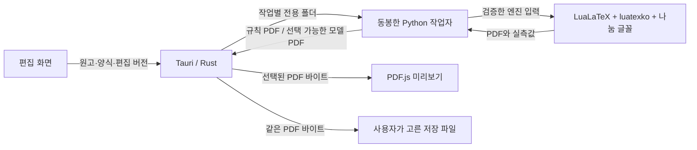

# 쪽결 데스크톱 앱 설계안

2026-11-20 제안 · 현재 웹판 기준 커밋 `24c014c` · 첫 검증 대상 Windows 11 x64

## 사용자가 받는 것

설치 파일 하나를 받아 오프라인에서 앱을 연다. 마크다운 원고와 양식 JSON을 선택하고, 한글을 수정하고, 두 쪽짜리 교정본을 미리본 뒤 PDF를 저장한다. Docker·Python·TeX·시스템용 나눔 글꼴을 사용자가 따로 설치하는 단계는 없다. 첫 검증 원고는 홀수쪽 오른쪽에 1~16번, 짝수쪽 왼쪽에 17~23번이 찍히는 양면 교정지다. [원고](../../../proofs/numbering/manuscript.md) · [양식](../../../proofs/numbering/odd-even.json) · [기준 PDF](../../../proofs/numbering/odd-even.pdf)

1안으로 **Tauri 2 앱, Rust 작업 관리자, 기존 편집 화면, 동봉한 Python 작업자와 LuaLaTeX**를 제안한다. 처음부터 Rust가 데스크톱의 파일과 작업 수명을 소유한다. 기존 웹판은 Docker에서 계속 실행하며 지면 비교의 기준으로 사용한다.

| 검토한 방식 | 쪽결에 미치는 영향 |
| --- | --- |
| Tauri와 기존 조판 엔진 | 기존 양식·줄바꿈·각주 동작을 유지하면서 세 OS의 설치·작업 관리를 새로 설계할 수 있다. 가장 먼저 확인할 비용은 TeX 배포 크기와 Windows 이식이다. |
| 기존 서버를 Docker로 띄우는 실행 앱 | 첫 시연은 빠르지만 사용자에게 Docker와 컨테이너 실행 환경이 필요하다. |
| 화면부터 조판까지 Rust로 재작성 | 장기적으로 Python과 TeX 동봉을 줄일 수 있다. 어절 보존, 자간 범위, 각주 이동, 모델의 줄바꿈 재현까지 다시 검증해야 한다. 같은 A5 원고도 LuaLaTeX와 Typst가 자간 −7%에서 다른 줄 끝을 냈다. [엔진 비교](../../../proofs/engine-comparison/side-by-side.pdf) |

Rust 조판 엔진 도입은 별도 결정으로 둔다. 첫 설치판에서 배포 크기나 조판 시간이 실제 병목으로 확인되면 같은 원고·양식으로 독립 시제품을 비교한다. 어절 경계, 좌우 폭, 주석 페이지가 모두 인수 기준을 통과하고 측정한 병목이 개선될 때 교체를 제안한다.

## 한 번의 미리보기에서 일어나는 일

| 책임 | 설계 |
| --- | --- |
| 편집 화면 | `app/static`의 원고·양식 조작을 재사용한다. 웹에서는 기존 HTTP를, 데스크톱에서는 Tauri 명령을 호출하는 얇은 연결부를 둔다. 시작할 때 `editor_bootstrap()`, 예제 원고, 지원 기능을 받은 뒤 폼을 초기화한다. 서버가 HTML에 설정을 삽입하던 순서도 시험한다. |
| Rust | 로컬 파일 대화상자, 작업 번호·편집 버전, 취소·시간 제한, 결과 보관, 파일 쓰기를 맡는다. 데스크톱은 별도 HTTP 포트를 열 필요가 없다. 사용자 파일은 선택한 대상에만 쓰고, 저장은 같은 폴더의 임시 파일을 완성한 뒤 교체한다. 저장 취소와 디스크 쓰기 실패 시 기존 파일을 보존한다. |
| Python | 기존 `Style`, 마크다운 파서, 목록·주석·구간 규칙과 엔진 입력 생성 함수를 공유한다. OS별로 PyInstaller의 디렉터리 배포 방식으로 패키징한다. 작업 종류를 받는 명시적 진입점을 두고 `sys.executable -m …`이 일반 Python을 실행한다고 가정하는 부분을 옮긴다. [기존 양식](../../../app/style.py) · [엔진 입력](../../../app/typeset.py) · [PyInstaller 배포 방식](https://pyinstaller.org/en/stable/operating-mode.html) |
| PDF | 자체 포함한 PDF.js와 전용 worker로 세 OS에서 같은 미리보기 경로를 쓴다. Rust가 보관한 결과를 이진 응답으로 전달한다. 선택을 바꾸면 이미 완성한 PDF를 읽고, 저장은 같은 결과를 파일에 복사한다. [Tauri 이진 응답](https://v2.tauri.app/develop/calling-rust/) · [PDF.js 예제](https://mozilla.github.io/pdf.js/examples/) |

### 파일 및 작업 계약

- **열기·저장.** 원고는 기존 UTF-8 마크다운 계약을 따른다. 열린 원고를 그대로 저장했을 때 BOM과 개행을 포함한 기존 왕복 동작을 대조한다. 양식 JSON의 길이는 정수 sp로 보존하고, 화면의 mm·pt 표시값은 `Style`에서 변환한다. 기존 파일에서 생략한 값과 명시적으로 끈 값, 입력 오류의 필드 경로와 메시지를 보존한다. 저장 대화상자가 열린 동안 편집해도 저장 버튼을 눌렀을 때의 버전을 쓴다.
- **조판 요청.** `start_render`는 원고·편집 양식·편집 버전을 받아 작업 ID를 즉시 돌려준다. 완료 통지는 작업 ID·편집 버전·사용 가능한 결과 종류(`rule`, `model`)·결정 상태(`rule`, `model`, `mixed`)를 전달한다. `read_proof`와 `save_proof`는 완료된 작업 ID와 선택한 종류를 받는다. 파일 경로와 임시 폴더는 Rust가 관리한다. 다운로드 시 편집 내용이 달라졌으면 최신 버전을 조판하고 그 결과를 저장한다.
- **취소와 복구.** 취소·원고 교체·창 닫기·기한 초과에 하위 엔진까지 정리한다. 새 요청보다 늦은 성공·실패는 화면에 적용하지 않는다. 마지막 정상 PDF는 후속 결과를 표시할 때까지 유지한다. Windows는 Job Object에 자식 실행 전부터 소속되도록 시작하고, macOS·Linux는 전용 프로세스 그룹을 쓴다. 앱을 강제 종료한 경우에도 다음 시작 시 사용 중인 다른 인스턴스를 건드리지 않고 자기 소유의 고아 작업 폴더를 회수하는지 시험한다. [현재 작업 관리](../../../app/jobs.py) · [Windows Job Objects](https://learn.microsoft.com/en-us/windows/win32/procthread/job-objects)
- **현재 한도.** 조판의 요청 크기 1MiB, 동시 작업 2건, 제한 30초, 작업자 파일당 64MiB는 기존 운영 설정에서 읽는다. Rust의 요청 크기 측정 대상은 기존 웹 요청과 같은 UTF-8 직렬화 바이트다. 원고 가져오기·참고 분석은 각자의 설정을 따른다. Windows의 프로세스 트리 관리와 파일당 출력 제한은 서로 다른 요구다. 크기 초과 쓰기, 기한, 취소 뒤 재시도가 실제로 제한되는지 각각 확인한다. [운영 설정](../../../app/config/operations.json) · [작업별 선택](../../../app/server.py)
- **동시 실행 범위.** 동시 작업 수는 앱 프로세스 단위로 센다. 창 여러 개가 한 프로세스를 쓰면 한도를 공유하고, 독립적으로 실행한 두 번째 앱은 자체 한도를 쓴다. 한쪽을 강제 종료해도 다른 쪽 작업과 저장이 끝나는지 검사한다.
- **작업자 경계.** Rust는 조판 요청 하나에 동봉한 작업자 하나를 시작한다. 전용 폴더의 `request.json`을 읽은 작업자가 LuaLaTeX를 실행하고 규칙 PDF, 선택 가능한 모델 PDF, 결과 상태를 정해진 파일에 쓴다. Rust가 종료 상태와 완성된 PDF를 확인한 뒤 편집기에 결과를 알린다. 실패 응답은 기존 API의 오류 코드·필드·메시지를 따른다. 웹 서버의 작업 관리자를 데스크톱에서 다시 띄울 필요가 없다.

## 조판 엔진을 설치 파일에 넣는 방법

1. **기준을 고정한다.** Docker판은 LuaHBTeX 1.15.0, luatexko 3.5, luaotfload 3.23과 고정한 나눔 글꼴을 쓴다. 공통 TeX 소스·패키지·폰트의 버전과 해시는 공유하고, 엔진 실행 파일·공유 라이브러리·Python 의존성 해시는 OS와 아키텍처별로 기록한다. 기존 Debian 절대 경로를 유지해야 하는 웹판과, 앱 리소스에 대한 상대 경로를 쓰는 데스크톱판의 검증기를 구분한다. [현재 버전·해시](../../../runtime.lock) · [Tauri 외부 실행 파일](https://v2.tauri.app/develop/sidecar/)
2. **Windows에서 엔진만 먼저 검증한다.** 같은 버전의 TeX Live 실행 파일·매크로·포맷 생성 도구와 필요한 DLL을 수집한다. 대상 OS에서 만든 포맷과 버전별 캐시를 사용한다. 기준과 같은 엔진을 확보하지 못하면 후보 버전을 기록하고 기준 PDF 전체를 비교한 후 채택한다. 시험 출력을 근거로 버전을 정하며, 자동으로 시스템 TeX를 발견해 대신 사용하는 동작은 두지 않는다.
3. **재배치 가능한 묶음을 만든다.** 전용 작업 폴더에는 원고와 엔진 입력 및 출력만 둔다. 엔진·템플릿은 설치 리소스의 절대 경로로 실행하고, 나눔 글꼴은 동봉한 실제 파일로 지정한다. 현재 `fonts` 디렉터리 심볼릭 링크, `PATH`의 `lualatex`, `/usr/share`와 관리자 권한 가정을 제거한다. 읽기 전용 설치 폴더, 공백·한글이 있는 사용자 경로, 빈 캐시의 첫 실행을 필수 시험으로 삼는다. 기존 `--no-shell-escape`와 작업별 격리를 유지한다.
4. **측정한 파일만 배포한다.** 기준 원고 전체에서 사용한 TeX 파일을 추적하고 동적 글꼴 로딩·포맷·첫 실행 의존성을 깨끗한 시스템에서 다시 확인한다. 현재 Linux 컨테이너의 디스크 사용량은 `/usr/share/texlive` 141MiB, `/usr/share/texmf` 45MiB, 나눔 글꼴 디렉터리 33MiB였다. 네이티브 설치 파일 크기는 시제품에서 압축 전후로 따로 측정한다. 파일 목록과 해시, 재배포 고지 및 필요한 라이선스 자료를 설치물에 포함한다.

## 기능별 출시 범위

| 범위 | 처음 사용자에게 제공할 동작 | 통과 기준 |
| --- | --- | --- |
| 세 OS 공통 규칙 조판 | 한글 입력, 원고·양식 열기·저장, 양끝맞춤, 일반 보고서, 9단계 목록, 주석, 양면 여백·줄 번호, PDF 미리보기·저장 | 기존 Docker판의 줄·쪽과 비교한다. 같은 글꼴로 첫 설치와 재실행에서 같은 지면을 낸다. |
| 모델과 규칙 선택 | 검증한 모델이 연결되면 동일한 후보에서 모델 지면을 먼저 보여 주고 사용자가 규칙 지면을 선택할 수 있다. 모델 미연결·시간 초과 시 정상 규칙 결과와 이유를 표시한다. | 첫 모델 검증 조합은 macOS Apple Silicon + 기존 LM Studio MLX이다. Windows·Linux의 모델 조합은 별도 검증 후 켠다. 모델 가능 플랫폼, 규칙 전용 플랫폼을 릴리즈 노트에 각각 명시한다. |
| 가져오기·참고 서식·AI 양식 제안 | 기존 Python 구현과 설정을 재사용한다. TXT·HTML·DOCX·HWPX·HWP 5 가져오기, 조 번호 고정, 참고 서식 시험·적용, 머리글·바닥글과 양식 제안을 개별 기능으로 대응시킨다. | 시험판에서 준비된 항목만 노출하고 기능표에 표시한다. 일반 배포 후보에서는 기존 오프라인 기능을 세 OS 모두 시험한다. PDF 참고 서식은 Poppler 도구, 스캔·AI 제안은 연결된 모델을 별도 점검한다. [기존 참고 파일 판독](../../../app/reference_media.py) |

모델에는 현재처럼 후보 ID와 측정값을 전달한다. 판단이 제한 시간 안에 끝나지 않으면 이미 만든 규칙 지면을 돌려준다. macOS에서 `/opt/decision-model`을 사용자 모델 경로로 바꾸되 가중치·토크나이저·양자화·런타임 검증은 보존한다. Windows·Linux에서 다른 런타임을 채택하려면 규칙과 다른 후보를 실제로 선택한 사례, 선택한 줄 끝의 재현, 각주 보존, 실패 후 규칙 복귀까지 확인한다. [현재 모델 계약](../../../app/config/decision.json) · [실모델 판정 사례](../decision-acceptance.md)

설치 파일에서는 모델 가중치를 제외한다. 모델 조판을 켠 사용자는 로컬 모델 경로를 지정하고 LM Studio를 연결한다. 데스크톱 작업자는 루프백 주소를 사용한다. 후보 비교·재현에 걸리는 시간까지 포함해 기한을 지키고, 기존 POSIX 전용 타이머는 Windows 모델 지원을 켜기 전에 대체한다.

## 패키지와 출시 순서

아래 OS·CPU는 최초 지원을 위한 제안이다. 버전별 지원 표에는 설치 시험을 통과한 환경을 기록한다.

| 검증 순서 | 제안 패키지 | 깨끗한 환경에서 확인할 사항 |
| --- | --- | --- |
| 1. Windows 11 x64 | NSIS `.exe`. WebView2 오프라인 설치 구성 | Docker·TeX·Python이 없는 표준 사용자 계정에서 설치, 오프라인 첫 조판, 취소 후 재시도, 제거. WebView2 포함 설치도 별도 확인한다. [Windows 설치 옵션](https://v2.tauri.app/distribute/windows-installer/) |
| 2. macOS 14 이상 Apple Silicon | 서명·공증한 `.app`을 담은 DMG | 다운로드한 DMG를 다른 Mac에서 열어 동봉 작업자와 엔진 실행, 한국어 입력, 모델·규칙 선택과 저장을 확인한다. [macOS 서명과 공증](https://v2.tauri.app/distribute/sign/macos/) |
| 3. Linux x86_64 | Ubuntu 24.04 LTS를 첫 기준으로 AppImage | 기준 배포판의 glibc·WebKitGTK 및 AppImage 실행 조건을 기록한다. 개발 라이브러리와 시스템 TeX가 없는 데스크톱에서 설치물의 첫 화면·PDF·한글 입력을 확인한다. [AppImage 호환 조건](https://v2.tauri.app/distribute/appimage/) |

**첫 시제품**은 Windows에서 명령줄로 기준 PDF 한 부를 만드는 데서 시작한다. 이어 Tauri 창에서 파일을 열고 해당 PDF를 미리보기·저장하는 수직 경로를 완성한다. **내부 시험판**은 세 운영체제별 빌드와 깨끗한 환경 설치 시험을 통과한 파일을 비공개 GitHub 초안 릴리즈에 모은다. **배포 후보**는 오프라인 기능표와 PDF 대조를 통과한 동일 파일을 대상으로 Windows 서명, macOS 서명·공증, 배포 파일 SHA-256 및 구성품 고지를 확인한다. 서명·공증 뒤 최종 파일을 다시 설치하고 그 파일의 해시를 게시한다. 인증서 사용과 릴리즈 발행은 별도 배포 작업이다. [Tauri GitHub 빌드 안내](https://v2.tauri.app/distribute/pipelines/github/)

## 출판 품질 합격 기준

| 시험 자료 | 독립적으로 확인할 결과 |
| --- | --- |
| [양끝맞춤 원고](../../../proofs/justified-publication/manuscript.md) | 문단별 줄 끝의 어절, 마지막 줄, 본문 좌우 경계를 검사한다. 기존 시험의 오른쪽 끝 허용 오차는 0.05 PDF pt다. 좁은 폭과 긴 어절에서는 현재 긴 단어 처리 규칙도 대조한다. |
| [일반 보고서](../../../proofs/general-report/general-report.pdf) · [9단계 목록](../../../proofs/numbering/outline-9.pdf) | 제목 테두리·글꼴·크기, 네 단계 표지와 들여쓰기, 9단계 누적 번호와 다음 줄 본문 시작점을 검사한다. |
| [양면 줄 번호](../../../proofs/numbering/odd-even.pdf) · [주석 원고](../../../proofs/annotations/manuscript.md) | 쪽 수, 1쪽 오른쪽 1~16과 2쪽 왼쪽 17~23, 번호가 없는 면 뒤의 순번, 각주가 참조와 같은 쪽인지, 메모의 PDF 제외를 검사한다. |
| [모델·규칙 인수 검사](../../../tests/test_proof_choice_acceptance.py) | 모델 출력을 기준 모델과, 규칙 출력을 기준 규칙과 비교한다. 선택만 바꾸면 재조판 횟수는 0이어야 한다. 현재 띄운 PDF와 저장한 파일의 SHA-256은 같아야 한다. |

비교 기준은 기존 `read_pages`가 추출한 쪽 크기, 줄별 문자, 글꼴, 크기·좌표다. 쪽 수·줄 끝·번호·주석 위치의 불일치는 출시 보류 사유다. 글꼴의 PDF 하위집합 접두사나 생성 시각 등 메타데이터는 지면 판독과 분리한다. 이미 정한 좌표별 오차를 따르고 새 오차가 필요하면 차이를 기록해 판독한 뒤 결정한다. 첫 조판·반복 조판 시간, 설치 용량, 오프라인 완주 결과는 환경별 실측으로 공개한다. [실제 PDF 판독 도구](../../../tests/pdf_metrics.py) · [기존 인수 기록](../plans/2026-11-20-editor-contract-refactor.md)

기준 PDF에 쓰지 않은 새 원고 한 편으로도 같은 검사를 반복한다. 판형과 본문 크기를 바꿔 어절이 한 줄에 들어갈 때의 보존 여부, 문단 마지막 줄을 제외한 양끝맞춤, 설정한 자간·어절 공백 범위를 검사한다. 모델을 연결한 환경에서는 두 결과를 각각 열어 저장하고, 사용자가 고른 쪽과 저장한 지면이 일치하는지 확인한다.
